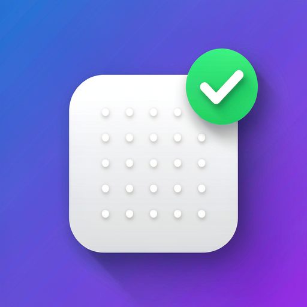

<div align="center">



# 🔧 WorkBuddy 本地云端自动签到

**让 WorkBuddy（腾讯 AI 编程助手）的每日签到领积分全自动完成，无需手动打开客户端。**

[English](./README_EN.md) | 简体中文

<p>

[](https://github.com/Alice9245426/workbuddy-auto-checkin/stargazers)
[](https://github.com/Alice9245426/workbuddy-auto-checkin/network)
[](https://github.com/Alice9245426/workbuddy-auto-checkin/issues)
[](https://github.com/Alice9245426/workbuddy-auto-checkin/pulls)
[](https://github.com/Alice9245426/workbuddy-auto-checkin/commits)
[](./LICENSE)
[](./CONTRIBUTING.md)

</p>

</div>

> ⚠️ **免责声明**：本项目仅供技术学习与交流，请遵守 WorkBuddy 的服务条款。签到接口由桌面客户端逆向而来，**并非官方公开 API**；云端方案每天从 GitHub Actions 的境外 IP 发起请求，与本机日常登录地不同。使用产生的任何后果（包括账号风控、要求重新登录、积分损失等）由使用者自行承担。**若准备把本项目推荐给他人，请先如实告知以上风险。**

---

## 📑 目录

- [功能特性](#-功能特性)
- [快速开始](#-快速开始)
- [用 Skill 一句话跑起来](#-用-skill-一句话跑起来)
- [分享给朋友：安全推荐指南](#-分享给朋友安全推荐指南)
- [目录结构](#-目录结构)
- [核心原理：登录态加密](#-核心原理登录态加密)
- [方案一：本地（Windows 任务计划）](#-方案一本地windows-任务计划)
- [方案二：云端（GitHub Actions）](#-方案二云端github-actions)
- [本地 vs 云端对比](#-本地-vs-云端对比)
- [token 续期机制](#-token-续期机制)
- [常见问题](#-常见问题)
- [贡献指南](#-贡献指南)
- [致谢](#-致谢)
- [许可证](#-许可证)

---

## ✨ 功能特性

| 特性 | 说明 |
|---|---|
| 🖥️ **本地方案** | Windows 任务计划 + 脚本，每天 00:00 准点签到，静默无窗口、不耗 AI token |
| ☁️ **云端方案** | GitHub Actions 定时运行，不依赖本地电脑，关机也能签到 |
| 🔁 **幂等安全** | 先查当天是否已签，已签则跳过，不会重复领取 |
| 🔐 **破解登录态加密** | 新版 WorkBuddy 对本地 token 做了信封加密，本项目给出客户端运行时内解密的完整思路 |
| 🛡️ **零敏感信息泄露** | 签到脚本的 token 全程走内存 / 环境变量 / GitHub Secrets，不打印；提取脚本仅在本机临时写两个 txt（用完即删） |
| 🔄 **自动续期** | 可选：配置 refreshToken 后，签到前自动刷新 accessToken，云端有效期从 30 天延长到约 60 天 |
| 📣 **结果通知** | 可选：签到结果推送到 Telegram / Server酱（微信）/ 通用 webhook |
| 🤖 **WorkBuddy Skill** | 附带 `SKILL.md`，说一句「帮我配置自动签到」即可由 AI 完成本地方案部署 |
| 🚀 **零依赖** | 云端脚本仅用 Python 标准库，无需 `pip install` 任何东西 |

---

## 🚀 快速开始

**🗣️ 最省事：让 WorkBuddy 帮你装（推荐，一句话）**

把本仓库的 `SKILL.md` 放进 WorkBuddy 的技能目录，或直接把仓库链接交给 AI 助手，然后说「帮我配置自动签到」。本地方案全程本机完成，**不需要 GitHub 账号、不需要授权**。详见 [用 Skill 一句话跑起来](#-用-skill-一句话跑起来)。

**只想在本地用（手动，电脑常开）**：

```powershell
# 一键：自检 + 注册计划任务（在本仓库目录下）
powershell -ExecutionPolicy Bypass -File .\scripts\setup_windows.ps1
```

或按 [「方案一」](#-方案一本地windows-任务计划) 手动分步操作。

**想不依赖电脑（云端兜底）**：

```bash
# 1. 在已登录 WorkBuddy 的电脑上提取登录信息
python extract_token.py            # 得到 uid / domain / token

# 2. 新建私有仓库，只上传 cloud_checkin.py 和 checkin.yml 两个文件
# 3. 在仓库 Settings → Secrets 配置 WB_TOKEN / WB_UID / WB_DOMAIN
# 4. Actions 页手动触发验证
```

> ⚠️ **云端方案请本人手动完成**：`accessToken` 是完整账号凭据，不要交给 AI 代劳；也**不要 Fork 本仓库**（会把提取脚本等无关文件一并带进去）。完整步骤见 [「方案二」](#-方案二云端github-actions)。若电脑经常开机，优先用上面的本地方案。

---

## 🤖 用 Skill 一句话跑起来

本项目附带一个 **WorkBuddy Skill**（`SKILL.md`），把本地方案的部署流程封装成 AI 可执行的指令。

### 安装 Skill（二选一）

- **方式 A（推荐）**：把仓库根目录的 `SKILL.md` 与 `scripts/` 一起复制到 WorkBuddy 的用户级技能目录：
  ```
  %USERPROFILE%\.workbuddy\skills\workbuddy-auto-checkin\
  ```
  保持 `SKILL.md` 在顶层、`scripts/setup_windows.ps1` 在子目录。
- **方式 B**：直接把仓库链接交给 AI 助手，让它读取 `SKILL.md` 并按其指令执行。

### 然后说一句话

> 「帮我配置 WorkBuddy 自动签到」

Skill 会自动完成：定位 `pythonw.exe` → 获取上游脚本 → `doctor` 自检 → `status` 只读验证 → 注册 2 个计划任务 → 回读校验。全过程**在本机完成，无需 GitHub 账号、无需授权、不耗 AI token**。

也可以直接手动跑那条命令（先在自检模式验证）：

```powershell
powershell -ExecutionPolicy Bypass -File .\scripts\setup_windows.ps1 -SkipRegister  # 自检，不写系统
powershell -ExecutionPolicy Bypass -File .\scripts\setup_windows.ps1                # 正式安装
```

> 已实测：`doctor` 识别 `sym-v1` 加密凭据、`status` 返回 HTTP 200、注册后强制触发 `LastTaskResult=0`、日志正常落盘。
>
> ⚠️ **Skill 只覆盖本地方案**。云端方案需要你本人的 GitHub 账号与 token，AI 不该代劳，请按 [「方案二」](#-方案二云端github-actions) 手动配置。

---

## 🎁 分享给朋友：安全推荐指南

> ⚠️ **不要**只说「帮我安装 GitHub 上的 workbuddy-auto-checkin」，也**不要**让 AI 替你处理账号凭据。原因见下。

### 为什么这句话会出问题

1. **「安装」这个词会跑偏**：本项目不是 pip / npm 包，也没有 `setup.py` / `pyproject.toml` / `package.json`。本地方案的正确动作是**运行一键脚本注册 Windows 计划任务**（或加载 `SKILL.md`），云端方案是**新建私有仓库 + 只上传 2 个文件 + 配置 Secrets**——都不是「安装」。
2. **同名仓库非常多**：GitHub 上搜 `workbuddy-auto-checkin` 有 **30 个**同名或近名仓库（还有下划线版 `workbuddy_auto_checkin`），其中有的 stars 比本项目更高。只报项目名，AI 很可能 clone 到**别人的同名项目**。
3. **确实可能"落到别人的项目"**：AI 若按字面去搜索并 fork/clone，没有明确指定作者，就会落到它搜到的第一个结果。你的 token 一旦配到陌生仓库，等于把账号凭据交给了别人的代码，这是最需要避免的风险。
4. **云端凭据不该交给 AI 代劳**：`extract_token.py` 解出的 `accessToken` 是**完整账号凭据**（等同账号密码），不是受限令牌。让 AI 代跑提取、写 Secrets、触发 Actions，等于把账号凭据交给一条自动执行的流程；本项目 `SKILL.md` 的「安全红线」也明确要求**不要替用户把 token 配置到任何 GitHub 仓库**。云端方案请本人手动完成。

### ✅ 推荐给朋友的正确说法

**默认推荐本地方案**——无需 GitHub 账号、无需交出任何凭据、token 由客户端自动滚动续期：

```text
我做了个 WorkBuddy 自动签到的小工具，本地方案最省事：
Windows 上先跑 scripts/setup_windows.ps1 -SkipRegister 自检，
通过后再去掉该参数正式安装，全程本机、不用 GitHub 账号。

云端方案要存完整账号 token、30 天要重提一次，接口是逆向的，
每天从 GitHub 境外 IP 签到，有账号风控风险，不建议一上来就用；
如果要试，请自己照 README「方案二」手动做，别交给 AI。

仓库（纯链接，别加粗、别用反引号包）：
https://github.com/Alice9245426/workbuddy-auto-checkin
```

### 更省心：直接甩链接

把仓库链接发给朋友，让 TA 自己照 README 做，或把链接贴给 TA 的 AI 助手：

```text
https://github.com/Alice9245426/workbuddy-auto-checkin
```

> 💡 发链接时**不要**用 Markdown 加粗（`**`）或反引号把 URL 包起来，直接贴纯地址——复制时把 `**` 一起带上会导致 GitHub 404。
>
> ⚠️ 如果要让朋友的 AI 助手读仓库，**只给链接**，不要附「帮我部署云端方案 / 帮我配置 Secrets」这类指令。云端步骤请朋友本人照 [「方案二」](#-方案二云端github-actions) 完成。

---

## 📁 目录结构

```
workbuddy-auto-checkin/
├── SKILL.md                      # WorkBuddy Skill：一句话完成本地方案部署
├── scripts/
│   └── setup_windows.ps1         # 一键安装脚本（自检 + 注册计划任务）
├── cloud_checkin.py              # 云端签到脚本（纯 Python 标准库，零依赖，含续期+通知）
├── extract_token.py              # 登录信息提取脚本（配云端 Secrets 用，一条命令）
├── .github/
│   ├── workflows/
│   │   ├── checkin.yml           # 签到定时配置（每日北京时间 00:00）
│   │   └── ci.yml                # CI 自检（语法 / 导入 / 无 token 干跑）
│   ├── ISSUE_TEMPLATE/           # Issue 模板
│   ├── PULL_REQUEST_TEMPLATE.md  # PR 模板
│   └── FUNDING.yml               # 赞助入口
├── assets/                       # logo 与社交预览图
├── CONTRIBUTING.md               # 贡献指南
├── CHANGELOG.md                  # 更新日志
├── CODE_OF_CONDUCT.md            # 行为准则
├── SECURITY.md                   # 安全政策
├── LICENSE                       # MIT
├── README.md                     # 中文文档
└── README_EN.md                  # English docs
```

---

## 🧠 核心原理：登录态加密

WorkBuddy **5.6.2+** 把本地登录态文件（`workbuddy-desktop.info`）里的 `accessToken`、`refreshToken`、`nickname` 做了**信封加密**，社区里大量早期签到脚本因此失效——它们读到的 token 是空字符串或 `$wbEncrypted` 占位。

逆向其客户端（`app.asar`）后确认的加密结构：

| 项目 | 值 |
|---|---|
| 算法 | AES-256-GCM |
| 附加认证数据（AAD） | `WB-AAD\0` |
| 密钥来源 | `keyblob` + `protectorKey`（系统凭据，DPAPI 保护），密钥不落盘 |
| 解密入口 | 客户端原生绑定 `electron_browser_workbuddy_storage.loggerGet()` |

因此正确的解密方式不是手动逆向 DPAPI，而是**让客户端自己在运行时解密**：

```bash
ELECTRON_RUN_AS_NODE=1 "WorkBuddy.exe" -e <js>
```

在客户端原生运行时里调用 `loggerGet()` 取 at-rest 密钥，`sha256` 派生 AES-256-GCM 密钥，配合 AAD `WB-AAD\0` 解 envelope。全程内存管道、密钥用完清零。

> 本地方案的解密实现参考了开源项目 [88lin/workbuddy-auto-signin](https://github.com/88lin/workbuddy-auto-signin)（MIT），该项目已验证此思路，推荐直接使用。

### 签到接口

签到接口从桌面端逆向而来（域 `copilot.tencent.com`）：

| 用途 | 接口 |
|---|---|
| 查签到状态 | `POST /v2/billing/meter/checkin-activity-status` |
| 执行签到 | `POST /v2/billing/meter/daily-checkin` |
| 刷新 accessToken | `POST /v2/plugin/auth/token/refresh`（请求头带 `X-Refresh-Token`） |

请求头（`domain` 为你的登录域，通常是 `www.workbuddy.cn`）：

```
Authorization: Bearer <accessToken>
X-User-Id: <uid>
X-Domain: <domain>
Content-Type: application/json
```

---

## 🖥️ 方案一：本地（Windows 任务计划）

### 原理

由 Windows「任务计划程序」定时调用脚本，脚本用本机登录态调官方接口签到。**不依赖 WorkBuddy 进程、不耗 AI token、无窗口**。

### 部署步骤

1. **获取脚本**：`git clone https://github.com/88lin/workbuddy-auto-signin.git`（MIT，已内置解密逻辑）。
2. **离线自检**：`python signin.py doctor` —— 验证你机器上的解密链路。
3. **只读验证**：`python signin.py status` —— 真正解密 token 并查签到状态（不领取）。
4. **注册计划任务**（以每天 00:00 为例）：

   ```powershell
   $pythonw = "C:\path\to\pythonw.exe"   # 用无窗口的 pythonw
   $signin = "D:\path\to\signin.py"

   $act  = New-ScheduledTaskAction -Execute $pythonw -Argument "`"$signin`" silent"
   $tri  = New-ScheduledTaskTrigger -Daily -At "00:00"
   $set  = New-ScheduledTaskSettingsSet -StartWhenAvailable -Hidden
   Register-ScheduledTask -TaskName "WorkBuddyAutoSignin" `
     -Action $act -Trigger $tri -Settings $set
   ```

5. **验证**：`Start-ScheduledTask -TaskName "WorkBuddyAutoSignin"` 强制触发一次，检查 `signin.log`。

> 💡 建议额外加一个「补签兜底」任务（如每天 06:00 / 12:00 / 18:00 各跑一次 `silent-poll`），防止 00:00 撞上关机/睡眠导致断签。

---

## ☁️ 方案二：云端（GitHub Actions）

### 原理

把 `accessToken` 存到 GitHub Secrets，GitHub Actions 每天定时跑 `cloud_checkin.py` 调接口签到。**完全不依赖本地电脑**。

> ⚠️ **先看清代价再开始**：`extract_token.py` 解出的是**完整账号 accessToken**（等同账号密码），不是只读或受限令牌，本项目也没有任何降权方案。云端每天从 GitHub Actions 的境外 IP 调用逆向接口，与你本机日常登录地不同，存在账号风控风险。**以下步骤请本人手动完成，不要交给 AI 代劳**（见 `SKILL.md` 安全红线）。

### 部署步骤

#### 1. 提取 accessToken

在**已登录 WorkBuddy 的电脑上**运行本仓库的提取脚本（自动定位客户端、内存解密、不联网、默认不打印明文）：

```bash
# 1. 下载本仓库到本机（只为了跑提取脚本，不需要 Fork）
git clone https://github.com/Alice9245426/workbuddy-auto-checkin.git
cd workbuddy-auto-checkin

# 2. 提取 uid / domain / accessToken / refreshToken
python extract_token.py
```

输出会显示 `uid` 和 `domain`，并把 `accessToken`（及可选的 `refreshToken`）写入 `wb_cloud_token.txt` / `wb_refresh_token.txt`。

> 需要 Python 3（用系统自带 `python` 即可）。若 WorkBuddy 装在非默认目录，脚本会自动从注册表探测；仍找不到时可用 `WORKBUDDY_EXE` 环境变量指定 `WorkBuddy.exe` 的完整路径。提取完请及时删除这两个 txt。

#### 2. 创建仓库并上传

> ⚠️ **不要 Fork 本仓库**：请新建私有仓库，并**只上传下面这 2 个文件**。Fork 会把 `extract_token.py`、`SKILL.md`、安装脚本等一并带进仓库，将来若同步上游更新，新代码就会带着你的完整账号凭据运行。私有仓库里只需要 `cloud_checkin.py` 和 `checkin.yml`。

```bash
gh repo create workbuddy-cloud-checkin --private
gh api -X PUT repos/<you>/workbuddy-cloud-checkin/contents/cloud_checkin.py \
  -f message="add script" -f content="$(base64 -w0 cloud_checkin.py)"
gh api -X PUT "repos/<you>/workbuddy-cloud-checkin/contents/.github/workflows/checkin.yml" \
  -f message="add workflow" -f content="$(base64 -w0 .github/workflows/checkin.yml)"
```

#### 3. 配置 Secrets

在仓库 **Settings → Secrets and variables → Actions** 里新增三个仓库密钥：

| 名称 | 值 |
|---|---|
| `WB_TOKEN` | 你的 accessToken |
| `WB_UID` | 你的 uid |
| `WB_DOMAIN` | `www.workbuddy.cn` |

或命令行：

```bash
gh secret set WB_TOKEN  --repo <you>/workbuddy-cloud-checkin < token.txt
gh secret set WB_UID    --repo <you>/workbuddy-cloud-checkin --body "<uid>"
gh secret set WB_DOMAIN --repo <you>/workbuddy-cloud-checkin --body "www.workbuddy.cn"
```

#### 4. 触发验证

仓库 **Actions** 页 → 选中工作流 → **Run workflow**，观察日志输出 `{"ok": true, ...}` 即成功。

#### 5. 结果通知（可选）

在 Secrets 里额外配置通知渠道后，签到结果（成功 / 已签 / 失败）会自动推送：

| Secret | 用途 | 说明 |
|---|---|---|
| `TG_BOT_TOKEN` + `TG_CHAT_ID` | Telegram | 通过 Bot API 推送 |
| `SERVERCHAN_KEY` | Server酱（微信） | 到 [sct.ftqq.com](https://sct.ftqq.com) 扫码绑定获取 SendKey |
| `NOTIFY_WEBHOOK` | 通用 webhook | POST 一个 JSON 到该地址 |

三个渠道可同时配置、互不冲突；都不配置则静默运行。

#### 6. token 自动续期（可选）

云端默认只存 `accessToken`（约 30 天过期）。若额外配置 `WB_REFRESH_TOKEN`（refreshToken），脚本会在签到前先调用刷新接口把 accessToken 换成新的，把云端有效期延长到约 **60 天**：

| Secret | 说明 |
|---|---|
| `WB_REFRESH_TOKEN` | refreshToken（与 accessToken 一起从本地登录态提取） |

> ⚠️ 刷新接口从客户端逆向，存在失效风险；刷新失败时会自动回退用原 `WB_TOKEN` 签到，不影响主流程。注意 refreshToken 本身也会过期（约 60 天），到期后仍需重新提取。
>
> ⚠️ **令牌竞争提醒**：服务端每次刷新都会轮换 refreshToken。云端每天刷新后，本机 WorkBuddy 客户端里保存的旧 refreshToken 可能失效，导致客户端下次自动续期失败、需要重新登录。若本机仍经常使用客户端，建议二选一：只走客户端自动续期（云端不配 `WB_REFRESH_TOKEN`），或接受偶尔重新提取 token。

### 定时说明与长期维护

`checkin.yml` 配置了三个**非整点** cron，互为兜底（脚本先查状态再签到，幂等，不会重复领积分）：

| cron (UTC) | 北京时间 | 作用 |
|---|---|---|
| `13 16 * * *` | 00:13 | 主签 |
| `37 16 * * *` | 00:37 | 兜底 1 |
| `7 17 * * *` | 01:22 | 兜底 2 |

> ⚠️ 早期版本用 `0 16 * * *`（UTC 整点）。2026-11-08 实测该时点**当天一次 `schedule` 运行都没有产生**（手动 `workflow_dispatch` 一直正常），整点高负载会直接跳过。故改为错峰 + 多时点；同时 workflow 内对失败重试 3 次（间隔 30 秒）。

云端方案用的是「一次性凭据快照」，下面几件事会让签到**静默中断**，建议设好提醒：

| 事项 | 时间点 | 处理 |
|---|---|---|
| `accessToken` 过期 | 提取后约 **30 天**（对应登录态里的 `expiresAt`） | 重新运行 `extract_token.py`，更新 `WB_TOKEN` |
| 本机重新登录 / 换账号 / 重装客户端 | 随时 | Secrets 里的快照可能提前失效，需重新提取 |
| GitHub 自动禁用 schedule | 仓库 **60 天无任何提交或活动** | 到 Actions 页重新启用工作流；平时偶尔推一次提交即可 |
| 单次请求失败 | 网络抖动 / 接口 5xx | workflow 内自动重试 3 次；三次都失败才漏签，建议配置第 5 步通知渠道避免静默失败 |
| 腾讯改接口或加风控 | 不可预测 | 见 [常见问题](#-常见问题) |

> 💡 如果**电脑经常开机**，[方案一（本地）](#-方案一本地windows-任务计划) 明显更稳：token 由客户端后台滚动续期、7 个触发点兜底、准点 00:00，不需要 GitHub 账号，也不涉及凭据外存。

#### 本地任务报 `NETWORK` / SSL EOF（实测 2026-11-08）

计划任务由 Windows 系统启动，会读取注册表的系统代理（`ProxyServer`），**不继承终端会话的 `HTTPS_PROXY`**。若该代理对腾讯域返回 `[SSL: UNEXPECTED_EOF_WHILE_READING]`，`signin.py` 跑满退避重试后会写 `"result": "NETWORK"`、`LastTaskResult=1`；但在终端手动跑 `status` 却可能成功（终端走的是另一个代理），很容易误判成脚本坏了。

排查方式：分别用「系统代理端口 / 终端代理端口 / 无代理直连」请求一次 `https://copilot.tencent.com/`，看哪条通路报 SSL EOF。定位后，**在用户级环境变量里设置 `NO_PROXY=copilot.tencent.com,*.tencent.com`**（只让该域名绕过代理，直连可用时最稳），再强制触发任务确认 `LastTaskResult=0`、日志出现 `ALREADY` / `CLAIMED`：

```powershell
[Environment]::SetEnvironmentVariable('NO_PROXY', 'copilot.tencent.com,*.tencent.com', 'User')
Start-ScheduledTask -TaskName "WorkBuddyAutoSignin"
Get-ScheduledTaskInfo -TaskName "WorkBuddyAutoSignin" | Select LastRunTime, LastTaskResult
```

注意：若你的网络**必须**走代理才能访问腾讯域，就不要设 `NO_PROXY`，改为修正该代理的分流规则。

---

## ⚖️ 本地 vs 云端对比

| 维度 | 本地方案 | 云端方案 |
|---|---|---|
| 依赖本地电脑 | ✅ 需要电脑开机 | ❌ 不需要 |
| 准点性 | ✅ 精确 00:00（+6 个补签点） | ⚠️ 00:13 起三个错峰时点，仍可能被延迟或跳过 |
| 维护成本 | ✅ 零（token 自动续期） | ⚠️ accessToken 30 天要重提 |
| 稳定性 | ✅ 高 | ⚠️ token 到期需重提、60 天无活动自动禁用 schedule、依赖 GitHub 排程 |
| 推荐场景 | 电脑常开 | 电脑可能长期关机 |

> 💡 两者可**同时使用**：同一天谁先到谁签，另一个幂等跳过，积分不会重复。

---

## 🔄 token 续期机制

登录态里的 token 有效期：

| 字段 | 有效期 | 说明 |
|---|---|---|
| `accessToken` | 30 天 | 调用接口用 |
| `refreshToken` | 60 天 | **滚动续期**：每刷新一次顺延 60 天 |

关键结论：

- `refreshExpiresAt = lastRefreshTime + 60 天`，**每次刷新都会顺延**，不是固定的绝对过期时间。
- 刷新由 **WorkBuddy 客户端后台**自动触发（无需手动登录）。
- 因此：**电脑常开 + 客户端后台常驻 → 本地 token 自动续期、永不失效**，本地方案可无限期自动运行。

云端 Secrets 里的 `accessToken` 是一次性快照（30 天后过期）。本项目的 `cloud_checkin.py` 已内置「存 `refreshToken` + 每天先刷新再签到」的自动续期能力（见上方「方案二」第 6 步），可把云端有效期延长到约 60 天（注意：可能与本地客户端产生令牌竞争）。

---

## ❓ 常见问题

<details>
<summary><b>Q：签到会重复领积分吗？</b></summary>
不会。脚本先查状态，当天已签则直接跳过（幂等）。
</details>

<details>
<summary><b>Q：本地和云端同时跑会冲突吗？</b></summary>
不会。同一天谁先到谁签，另一个幂等跳过，积分不会重复。
</details>

<details>
<summary><b>Q：登录态过期了怎么办？</b></summary>
本地：打开一次 WorkBuddy 客户端即可恢复（后台会自动刷新）。<br>
云端：需要重新提取一次 accessToken 更新 Secrets。
</details>

<details>
<summary><b>Q：腾讯改版/加风控了怎么办？</b></summary>
接口从桌面端逆向，存在失效可能。若脚本报错，通常需重新逆向接口；若账号被风控要求重新登录，任何方案都无法绕过。
</details>

<details>
<summary><b>Q：为什么公开仓库的 workflow 会报错？</b></summary>
公开仓库未配置 Secrets（也不应配置），定时触发会因缺 `WB_TOKEN` 失败，属预期行为。请按 [「方案二」](#-方案二云端github-actions) 新建私有仓库并配置 Secrets 使用。
</details>

---

## 🤝 贡献指南

欢迎任何形式的贡献！请先阅读 [CONTRIBUTING.md](./CONTRIBUTING.md)，了解提 Issue、发 PR 的规范。

[](./CONTRIBUTING.md)

---

## 🙏 致谢

- [88lin/workbuddy-auto-signin](https://github.com/88lin/workbuddy-auto-signin)（MIT）—— 本地解密与签到思路的主要参考。

## 📄 许可证

本项目基于 [MIT](./LICENSE) 许可证开源。
