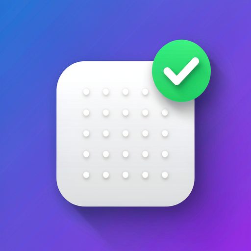

<div align="center">



# 🔧 WorkBuddy Auto Check-in

**Fully automate WorkBuddy (Tencent AI assistant) daily check-in to earn credits — no need to manually open the client.**

[简体中文](./README.md) | English

<p>

[](https://github.com/Alice9245426/workbuddy-auto-checkin/stargazers)
[](https://github.com/Alice9245426/workbuddy-auto-checkin/network)
[](https://github.com/Alice9245426/workbuddy-auto-checkin/issues)
[](https://github.com/Alice9245426/workbuddy-auto-checkin/pulls)
[](https://github.com/Alice9245426/workbuddy-auto-checkin/commits)
[](./LICENSE)
[](./CONTRIBUTING.md)

</p>

</div>

> ⚠️ **Disclaimer**: This project is for technical learning and research only. Please comply with WorkBuddy's Terms of Service. The user assumes all consequences (including account risk control, credit loss, etc.).

---

## 📑 Table of Contents

- [Features](#-features)
- [Quick Start](#-quick-start)
- [Project Structure](#-project-structure)
- [How It Works: Encrypted Credentials](#-how-it-works-encrypted-credentials)
- [Option 1: Local (Windows Task Scheduler)](#-option-1-local-windows-task-scheduler)
- [Option 2: Cloud (GitHub Actions)](#-option-2-cloud-github-actions)
- [Local vs Cloud](#-local-vs-cloud)
- [Token Renewal Mechanism](#-token-renewal-mechanism)
- [FAQ](#-faq)
- [Contributing](#-contributing)
- [Acknowledgements](#-acknowledgements)
- [License](#-license)

---

## ✨ Features

| Feature | Description |
|---|---|
| 🖥️ **Local option** | Windows Task Scheduler + script, checks in at 00:00 sharp, silent, no AI token cost |
| ☁️ **Cloud option** | Runs on GitHub Actions, works even when your PC is off |
| 🔁 **Idempotent** | Checks today's status first; skips if already checked in |
| 🔐 **Breaks credential encryption** | Provides a complete approach to decrypt WorkBuddy's new envelope-encrypted tokens |
| 🛡️ **Zero credential leak** | Tokens stay in memory / env vars / GitHub Secrets, never printed or written to disk |
| 🚀 **Zero dependencies** | Cloud script uses only the Python standard library |

---

## 🚀 Quick Start

**Local only (recommended if your PC is usually on)**:

```bash
# 1. Clone the local script that already solves the encryption
git clone https://github.com/88lin/workbuddy-auto-signin.git
cd workbuddy-auto-signin

# 2. Offline self-check + read-only verification
python signin.py doctor
python signin.py status

# 3. Register a Windows scheduled task (see "Option 1")
```

**Cloud only (PC-independent fallback)**:

```bash
# 1. Fork this repository
# 2. Configure WB_TOKEN / WB_UID / WB_DOMAIN in repo Settings → Secrets
# 3. Trigger manually from the Actions tab to verify
```

---

## 📁 Project Structure

```
workbuddy-auto-checkin/
├── cloud_checkin.py              # Cloud check-in script (pure stdlib, zero deps)
├── .github/
│   ├── workflows/
│   │   └── checkin.yml           # GitHub Actions schedule config
│   ├── ISSUE_TEMPLATE/           # Issue templates
│   └── PULL_REQUEST_TEMPLATE.md  # PR template
├── CONTRIBUTING.md               # Contribution guide
├── CHANGELOG.md                  # Changelog
├── CODE_OF_CONDUCT.md            # Code of conduct
├── SECURITY.md                   # Security policy
├── LICENSE                       # MIT
├── README.md                     # 中文文档
└── README_EN.md                  # English docs
```

---

## 🧠 How It Works: Encrypted Credentials

WorkBuddy **5.6.2+** envelope-encrypts `accessToken`, `refreshToken`, and `nickname` in the local credential file (`workbuddy-desktop.info`). Many early community scripts broke because they read an empty token or the `$wbEncrypted` placeholder.

Reverse-engineering the client (`app.asar`) reveals:

| Item | Value |
|---|---|
| Algorithm | AES-256-GCM |
| AAD | `WB-AAD\0` |
| Key source | Derived from `keyblob` + `protectorKey` (system credential, DPAPI-protected); key never touches disk |
| Decrypt entry | Native binding `electron_browser_workbuddy_storage.loggerGet()` |

Therefore the correct approach is **not** to reverse DPAPI by hand, but to let the client decrypt at runtime:

```bash
ELECTRON_RUN_AS_NODE=1 "WorkBuddy.exe" -e <js>
```

Call `loggerGet()` inside the client's native runtime to obtain the at-rest key, derive the AES-256-GCM key with `sha256`, and decrypt the envelope with AAD `WB-AAD\0`. All in-memory, key zeroed after use.

> The local decryption implementation references the open-source project [88lin/workbuddy-auto-signin](https://github.com/88lin/workbuddy-auto-signin) (MIT), which has verified this approach.

### Check-in API

Reversed from the desktop client (domain `copilot.tencent.com`):

| Purpose | Endpoint |
|---|---|
| Query status | `POST /v2/billing/meter/checkin-activity-status` |
| Perform check-in | `POST /v2/billing/meter/daily-checkin` |

Headers (`domain` is usually `www.workbuddy.cn`):

```
Authorization: Bearer <accessToken>
X-User-Id: <uid>
X-Domain: <domain>
Content-Type: application/json
```

---

## 🖥️ Option 1: Local (Windows Task Scheduler)

### How it works

Windows Task Scheduler runs the script on a schedule; the script calls the official API using local credentials. **No WorkBuddy process, no AI token cost, no window.**

### Steps

1. **Get the script**: `git clone https://github.com/88lin/workbuddy-auto-signin.git` (MIT, decryption built in).
2. **Offline self-check**: `python signin.py doctor` — verifies your decryption pipeline.
3. **Read-only verify**: `python signin.py status` — decrypts the token and queries status (does not claim).
4. **Register the task** (daily at 00:00):

   ```powershell
   $pythonw = "C:\path\to\pythonw.exe"   # windowless pythonw
   $signin = "D:\path\to\signin.py"

   $act  = New-ScheduledTaskAction -Execute $pythonw -Argument "`"$signin`" silent"
   $tri  = New-ScheduledTaskTrigger -Daily -At "00:00"
   $set  = New-ScheduledTaskSettingsSet -StartWhenAvailable -Hidden
   Register-ScheduledTask -TaskName "WorkBuddyAutoSignin" `
     -Action $act -Trigger $tri -Settings $set
   ```

5. **Verify**: `Start-ScheduledTask -TaskName "WorkBuddyAutoSignin"`, then check `signin.log`.

> 💡 Add a catch-up task (e.g. `silent-poll` at 06:00 / 12:00 / 18:00) to avoid missing a day when the PC is off at 00:00.

---

## ☁️ Option 2: Cloud (GitHub Actions)

### How it works

Store `accessToken` in GitHub Secrets; GitHub Actions runs `cloud_checkin.py` on a schedule. **Fully independent of your local PC.**

### Steps

#### 1. Extract accessToken

The local script (88lin) already has decryption capability. Write a 3-line script that reuses its decrypt function (calls `loggerGet()` to decrypt `$wbEncrypted`), yielding a JWT-form `accessToken` plus your `uid` and `domain`.

#### 2. Create a repo and upload

```bash
gh repo create workbuddy-cloud-checkin --private
gh api -X PUT repos/<you>/workbuddy-cloud-checkin/contents/cloud_checkin.py \
  -f message="add script" -f content="$(base64 -w0 cloud_checkin.py)"
gh api -X PUT "repos/<you>/workbuddy-cloud-checkin/contents/.github/workflows/checkin.yml" \
  -f message="add workflow" -f content="$(base64 -w0 .github/workflows/checkin.yml)"
```

#### 3. Configure Secrets

Add three repository secrets under **Settings → Secrets and variables → Actions**:

| Name | Value |
|---|---|
| `WB_TOKEN` | Your accessToken |
| `WB_UID` | Your uid |
| `WB_DOMAIN` | `www.workbuddy.cn` |

Or via CLI:

```bash
gh secret set WB_TOKEN  --repo <you>/workbuddy-cloud-checkin < token.txt
gh secret set WB_UID    --repo <you>/workbuddy-cloud-checkin --body "<uid>"
gh secret set WB_DOMAIN --repo <you>/workbuddy-cloud-checkin --body "www.workbuddy.cn"
```

#### 4. Trigger to verify

Repo **Actions** tab → select the workflow → **Run workflow**. Success if the log shows `{"ok": true, ...}`.

### Schedule note

`checkin.yml` cron `0 16 * * *` corresponds to **00:00 Beijing time** (UTC+8). GitHub Actions schedules are not exact and may lag a few to a dozen minutes.

---

## ⚖️ Local vs Cloud

| Dimension | Local | Cloud |
|---|---|---|
| Depends on local PC | ✅ PC must be on | ❌ No |
| Punctuality | ✅ Exact 00:00 | ⚠️ Lag (minutes) |
| Maintenance | ✅ None (auto-renewal) | ⚠️ Re-extract accessToken every 30 days |
| Stability | ✅ High | ⚠️ Subject to GitHub free-tier limits |
| Best for | PC usually on | PC may be off for long |

> 💡 You can run **both** together: whichever runs first checks in, the other idempotently skips. Credits are never doubled.

---

## 🔄 Token Renewal Mechanism

Credential expiry:

| Field | Validity | Notes |
|---|---|---|
| `accessToken` | 30 days | Used for API calls |
| `refreshToken` | 60 days | **Sliding renewal**: each refresh extends by 60 days |

Key findings:

- `refreshExpiresAt = lastRefreshTime + 60 days` — **each refresh pushes it forward**, not a fixed absolute expiry.
- Refresh is triggered **automatically by the WorkBuddy client in the background** (no manual login).
- Therefore: **PC usually on + client resident in background → local token auto-renews and never expires**, so the local option can run indefinitely.

The cloud `accessToken` in Secrets is a one-time snapshot (expires in 30 days). For a long-lived cloud setup, you could extend it into a "store `refreshToken` + refresh before check-in" loop (note: may compete with the local client for the token).

---

## ❓ FAQ

<details>
<summary><b>Q: Will check-in duplicate credits?</b></summary>
No. The script queries status first and skips if already checked in (idempotent).
</details>

<details>
<summary><b>Q: Do local and cloud conflict?</b></summary>
No. Whichever runs first checks in, the other skips. Credits are never doubled.
</details>

<details>
<summary><b>Q: What if credentials expire?</b></summary>
Local: open the WorkBuddy client once to restore (background auto-refresh).<br>
Cloud: re-extract the accessToken and update Secrets.
</details>

<details>
<summary><b>Q: What if Tencent changes the API or adds risk control?</b></summary>
The API is reversed from the client and may break. If the script errors, re-reverse the API; if the account is forced to re-login by risk control, no approach can bypass it.
</details>

<details>
<summary><b>Q: Why does the workflow in the public repo error?</b></summary>
The public repo has no Secrets (and should not), so scheduled runs fail with a missing `WB_TOKEN`. This is expected. Fork and configure Secrets in your own repo to use it.
</details>

---

## 🤝 Contributing

Contributions are welcome! Please read [CONTRIBUTING.md](./CONTRIBUTING.md) first.

[](./CONTRIBUTING.md)

---

## 🙏 Acknowledgements

- [88lin/workbuddy-auto-signin](https://github.com/88lin/workbuddy-auto-signin) (MIT) — main reference for local decryption and check-in.

## 📄 License

Released under the [MIT](./LICENSE) license.
